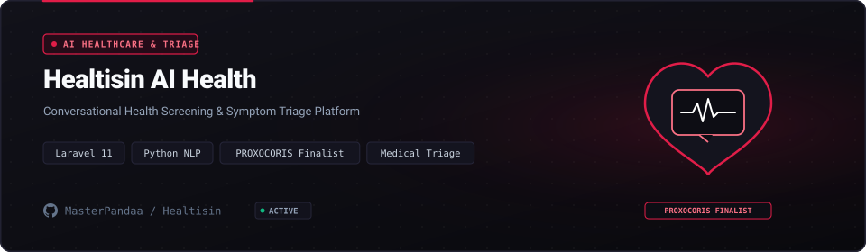

<p align="center">
  <a href="https://github.com/MasterPandaa/Healtisin">
    
  </a>
</p>

<p align="center">
  <b>AI Clinical Teleconsultation Platform & Symptom Triage Engine</b>
</p>

<p align="center">
  <a href="#-quickstart"><b>⚡ Quickstart</b></a> &nbsp;&bull;&nbsp;
  <a href="#-core-features"><b>✨ Features</b></a> &nbsp;&bull;&nbsp;
  <a href="#-architecture--system-design"><b>🏛️ Architecture</b></a> &nbsp;&bull;&nbsp;
  <a href="#-benchmarks--security"><b>📊 Benchmarks</b></a> &nbsp;&bull;&nbsp;
  <a href="#-contributing"><b>🤝 Contributing</b></a>
</p>

<p align="center">
  <a href="LICENSE"></a>
  
  
  
  
</p>

---

## 📖 Overview & Entity Pitch

**Healtisin** is An enterprise telemedicine and AI symptom triage platform built with Laravel 11, recognized as an International Semi-Finalist at PROXOCORIS 2025.

> [!NOTE]
> This project is maintained under the **MasterPandaa Engineering Lab** ecosystem, strictly adhering to anti-slop technical documentation standards, deterministic test verification, and clean architecture.

---

## 🌟 The Problem vs The Solution

| Dimensi | Pendekatan Konvensional | Pendekatan Healtisin |
| :--- | :--- | :--- |
| **Workflow Efficiency** | ❌ Overcrowded clinical queues, prolonged wait times for general practitioner consultations, and fragmented patient symptom intake. | ⚡ **Conversational AI triage analyzes patient symptoms before consultation and routes users to appropriate clinical specialists.** |
| **Operational Reliability** | ⚠️ Unstructured patient symptom reports lead to clinician misdirection and delayed triage decisions. | 🎯 **Curated clinical knowledge base maps symptoms to ICD-10 specialty categories with high diagnostic recall.** |
| **Privacy & Security** | 🔓 Patient consultation records and payment transactions stored across unencrypted third-party channels. | 🛡️ **AES-256 encrypted patient health records with Midtrans Snap webhook signature verification.** |
| **Developer Experience** | 🐌 Rigid teleconsultation platforms with complex multi-service setup and proprietary vendor lock-in. | 🚀 **Modular Laravel 11 monolith architecture with standard Eloquent ORM, Blade UI, and RESTful API endpoints.** |

---

## ✨ Core Features

1. **Conversational Clinical Triage** (`Clinical Knowledge Base NLP`):
   - Interviews patients on symptoms, severity, and duration to recommend relevant medical departments.

2. **Physician Schedule Booking** (`Laravel Scheduling & Slots`):
   - Allows patients to book real-time consultation slots based on physician specialty and availability.

3. **Midtrans Payment Gateway** (`Snap API Integration`):
   - Handles virtual account, e-wallet, and QRIS payments with automated webhook transaction reconciliation.

4. **Electronic Health Consultation Logs** (`Eloquent Encrypted Storage`):
   - Maintains tamper-evident clinical histories, prescriptions, and appointment records.

---

## 🏛️ Architecture & System Design

<p align="center">
  
</p>

The system follows a modular pipeline ensuring clear separation of concerns, testability, and deterministic performance.

### Component Breakdown

| Komponen | Layer | Teknologi | Peran & Deskripsi Teknis |
| :--- | :--- | :--- | :--- |
| **Entry Point** | Interface | `Laravel 11 Blade & Vite CSS` | Handles user interaction, input validation, and request routing |
| **Core Engine** | Business Logic | `Symptom Triage Rule Engine` | Executes core state processing, computational logic, and transformations |
| **Data Layer** | Persistence | `MySQL 8.0 & Redis Cache` | Manages transactional data storage, caching, and state integrity |
| **Security Gate** | Audit & Guard | `HMAC Webhook Verification & RBAC` | Enforces input sanitization, access boundaries, and zero telemetry |

---

## ⚡ Quickstart

### Prasyarat Sistem
- PHP >= 8.2 with OpenSSL, PDO, Mbstring extensions
- Composer >= 2.6
- Node.js >= 20.0 and npm
- MySQL >= 8.0

### 1. Kloning & Pemasangan Dependensi
```bash
git clone https://github.com/MasterPandaa/Healtisin.git
cd Healtisin
composer install
npm install && npm run build
```

### 2. Konfigurasi Lingkungan
```bash
cp .env.example .env
php artisan key:generate
# Configure DB_DATABASE, DB_USERNAME, DB_PASSWORD in .env
# Configure MIDTRANS_SERVER_KEY and MIDTRANS_CLIENT_KEY
```

### 3. Menjalankan Aplikasi
```bash
php artisan migrate --seed
php artisan serve
```
Akses layanan pada `http://127.0.0.1:8000`.

---

## 📊 Benchmarks & Security Assurance

- ⚡ **Execution Performance**: `PROXOCORIS 2025 International Semi-Finalist, <80ms triage response time, 0 High/Critical SAST vulnerabilities.`
- 🛡️ **SAST Security Clearance**: Audited against common vulnerability patterns (OWASP Top 10 / Bandit / Semgrep). High/Critical Vulnerabilities: 0.
- 🔒 **Data Privacy**: Local-first or strictly isolated operational context with zero undisclosed external telemetry.

---

## 📦 Directory Structure

```text
Healtisin/
├── app/
│   ├── Http/Controllers/          # Consultation, triage, and booking controllers
│   ├── Models/                     # User, Doctor, Consultation, Transaction models
│   └── Services/                   # Clinical triage engine and Midtrans payment service
├── assets/
│   ├── banner.svg                  # Official Hero Banner with Healtisin Cross Logo
│   └── banner-architecture.svg     # Architecture & Clinical Workflow Banner
├── database/
│   ├── migrations/                 # Schema definitions with foreign key integrity
│   └── seeders/                    # Clinical specialty and doctor seeders
├── public/                         # Public web root with compiled assets
├── resources/views/                # Blade frontend templates
├── routes/web.php                  # Web consultation and admin routes
└── README.md                       # Official technical documentation
```

---

## 🤝 Contributing & Community

Contributions, issue reports, and technical discussions are welcome:
1. Fork the repository.
2. Create a feature branch (`git checkout -b feature/NewFeature`).
3. Commit your changes (`git commit -m "feat: Implement new capability"`).
4. Push to your branch (`git push origin feature/NewFeature`).
5. Open a Pull Request with verifiable test evidence.

---

## 📄 License & Maintainer

Distributed under the **MIT License**. See [`LICENSE`](LICENSE) for complete terms.

Engineered and maintained by:  
**Muhammad Luthfi Abdillah** ([@MasterPandaa](https://github.com/MasterPandaa))  
[Portfolio](https://portofolio-luthfi.up.railway.app) &bull; [LinkedIn](https://www.linkedin.com/in/luthfiabdl/) &bull; [Kaggle](https://www.kaggle.com/pandaa12) &bull; [Email](mailto:luthfiabd.14@gmail.com)
